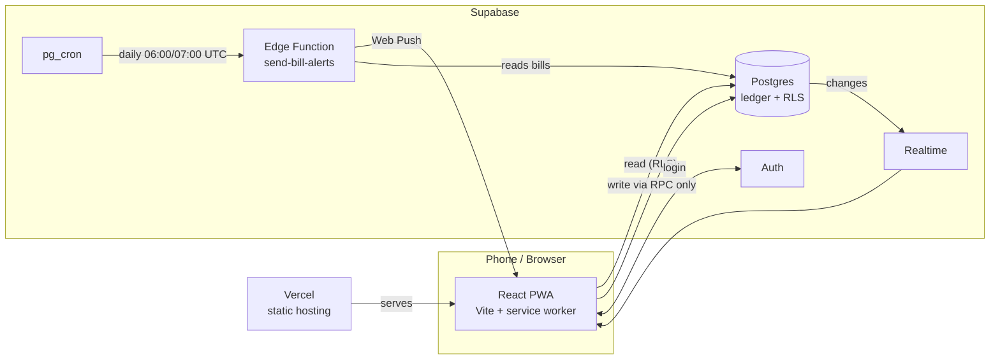

# Family Wallet

A private, installable web app (PWA) that lets a family manage money together: a shared pool, personal wallets,
cards for specific purposes, bills, spending limits and statistics, in USD and Lebanese pounds (LBP). Everyone in the
family sees the same synced data on their own phone; admins set the rules.

It is built for **one family**, not as a public product. It runs on free tiers (Supabase + Vercel), has no
native app, and keeps data usage low (small payloads, cached app shell, paginated lists).

> **Status:** in daily use and under active development. The UI is English only.

---

## What it does

| Area | What you can do |
|---|---|
| **Family and roles** | Create a family, invite members with a link. Three roles: **superadmin** (the creator, cannot be demoted or removed), **admin** (manages money and settings), **member**. Roles are enforced by the database, not just hidden in the UI. |
| **Wallets** | A **family pool** (shared money), each member's **main wallet** (cash in hand), private **pockets** (savings goals only the owner sees) and **cards** (purpose-specific wallets such as "Groceries card", managed by admins). |
| **Multi-currency** | Every wallet holds USD and/or LBP. Each record stores the exchange rate it was made at, so history never shifts when rates change. Admins set and override the family rate; members' rates must stay close to it. |
| **Spending** | Log expenses with category, note, date and (for card spending) who it was for. Edit or delete your own; admins can fix anyone's. Balances recalculate automatically and a wallet can never go below zero. |
| **Money in** | Record money from outside the family: salary, bonus, gift, other, or a **reimbursement** (which lowers the spending of the category it pays back, and can count for a specific person). |
| **Limits and budgets** | Per-member spending limits, a family budget target and per-category budgets. A reimbursement lowers the limits it affects. In-app warnings when someone is close to or over a limit. |
| **Bills** | Family bills (paid by admins from the pool or a card) and personal bills (paid from your own wallet). Monthly, weekly or one-time, with a Bills page, due-soon summary and phone reminders. |
| **Statistics** | Spending by category, person and day for any period, with drill-down to the underlying records (expenses and reimbursements). |
| **Common expenses** | Costs the whole family shares, paid from the pool or a card, optionally attributed to one person. |
| **Phone alerts** | A push notification at 09:00 (Beirut time) for bills due soon or overdue, to each person who turns it on. |
| **Installable** | Add to Home Screen on iOS or Android: full-screen, offline app shell, update prompt when a new version is ready. |

---

## How it fits together



There is **no custom backend server**. The browser talks directly to Supabase, and all money rules live in the
database as functions. The front end is deliberately thin.

### Key design decisions

- **A real ledger, not editable balances.** Every wallet is a row in `wallet_accounts`; every movement is a row in
  `wallet_entries`. The balance is cached on the account and recomputed in one place (`_settle()`); the rule
  "no wallet below zero" is checked at commit time.
- **Writes only through database functions.** Clients can *read* their family's data but cannot write to the money
  tables. Every change goes through a `SECURITY DEFINER` function (`create_income`, `update_income`,
  `pay_common_bill`, ...) that checks who is calling, their role and the business rules, and locks the affected
  accounts to avoid races.
- **Row Level Security is the security boundary.** Data is family-wide readable, with exceptions (a member's pockets
  are private to them). The UI hides what you cannot do, but the database is what actually refuses.
- **Snapshots over recalculation.** Each record keeps its own exchange rate, so statistics and history are stable.
- **Reversible changes.** Every database migration has a rollback script and a test file, run on a scratch project
  before the live one.
- **Dates use the Beirut calendar** (`Asia/Beirut`) so "today", periods and the 09:00 alert mean the same thing for
  everyone.

---

## Tech stack

| Layer | Choice |
|---|---|
| Front end | React 18, Vite 5, React Router, Recharts |
| PWA | `vite-plugin-pwa` (Workbox, update prompt), hand-written push handler |
| Backend | Supabase: Postgres, Auth, Realtime, Edge Functions (Deno) |
| Notifications | Web Push (VAPID) sent by an Edge Function on a `pg_cron` schedule |
| Hosting | Vercel (static build) |
| Language | JavaScript (JSX) on the client, SQL and PL/pgSQL for the rules, TypeScript for the Edge Function |

---

## Repository layout

```
src/
  pages/            screens and sheets (Dashboard, Statistics, Bills, forms, edit sheets)
  components/       small shared pieces (amount input, chips, confirm dialog, PWA status, push toggle)
  lib/              data access and logic (wallets.js, bills.js, budgets.js, push.js, formatting, roles)
  AuthContext.jsx   session and current member
public/             icons, push service-worker script
supabase/
  schema.sql        the original base schema (before the ledger)
  migrations/       numbered SQL migrations 0001 to 0018, with its own README (order, rollback ladder)
  rollback/         one *_down.sql per migration
  tests/            SQL test files for each migration (scratch projects only)
  audit/            read-only audit and integrity-check queries
  functions/        send-bill-alerts (Edge Function) and its README
vite.config.js      PWA manifest and caching rules
```

---

## Running it yourself

You need Node 18+ and a free [Supabase](https://supabase.com) project.

```bash
npm install
cp .env.example .env.local     # fill in your Supabase URL and anon key (never commit this file)
npm run dev                    # http://localhost:5173
npm run build                  # production build in dist/
```

**Database.** Run `supabase/schema.sql`, then the numbered files in `supabase/migrations/` in order. Read
`supabase/migrations/README.md` first: it explains the order, how each migration is tested on a scratch project,
and the rollback ladder. **Never run a migration on live data before a scratch run.**

**Phone alerts (optional).** Setup is in `supabase/functions/send-bill-alerts/README.md`: generate VAPID keys, set
the function's secrets, deploy it with JWT verification off (it checks its own secret or the caller's login), and
schedule it with `supabase/push_schedule.example.sql`. The public key goes in `VITE_VAPID_PUBLIC_KEY`; the private
key stays a Supabase secret.

**Deploy.** Connect the repo to Vercel with the two `VITE_` variables (and the VAPID public key). Pushes to the main
branch deploy automatically. Installed apps show a "new version ready" banner; the new version takes over when
the user taps it.

### Secrets: what goes where

| Value | Where | Public? |
|---|---|---|
| Supabase URL and anon key | `.env.local`, Vercel env vars | Yes (protected by RLS) |
| VAPID public key | `VITE_VAPID_PUBLIC_KEY` | Yes |
| VAPID private key, `CRON_SECRET` | Supabase function secrets only | **No** |
| Supabase service-role key | Edge Function runtime only | **No** |

`.env.local`, build output and `*.zip` files are git-ignored.

---

## Testing

There is no front-end test suite yet. Money logic is tested in SQL: each `supabase/tests/*.sql` file is pasted into
the Supabase SQL editor of a **scratch** project, creates what it needs, asserts the rules (permissions, balances,
refusals, rollbacks) and removes everything again. A clean run ends with an "ALL ... PASSED" row. The front end is
checked with a production build (`npm run build`) and by hand.

---

## How it was built

Iteratively, one vertical slice at a time: a short mockup for bigger changes, then the database function with its
tests, then the screen, then a build check, driven by real use of the app. The original five-day scope is in the
project spec; the ledger, pockets, cards, bills, money-in, edits and phone alerts were added afterwards.

## Known limits and ideas

- Phone alerts on iPhone need the app added to the Home Screen first (iOS 16.4+).
- Notification muting (per bill or "mute for a while") and yearly bills are not built yet.
- Not included: receipt photos, approval workflows, CSV/PDF export, offline editing with conflict resolution,
  native iOS/Android apps, multi-family (multi-tenant) support, other languages.
- This is a personal family tool: no formal uptime promise, no compliance program.
